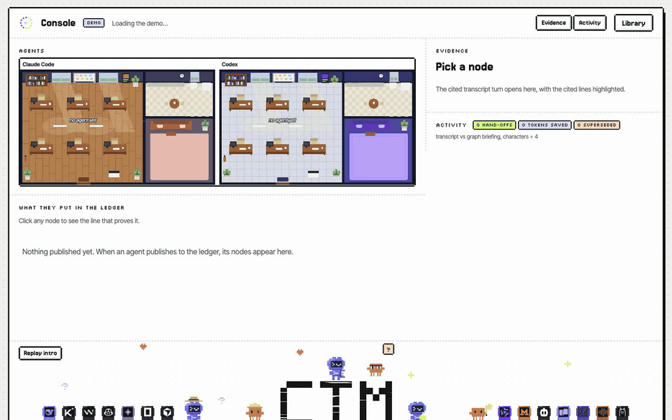
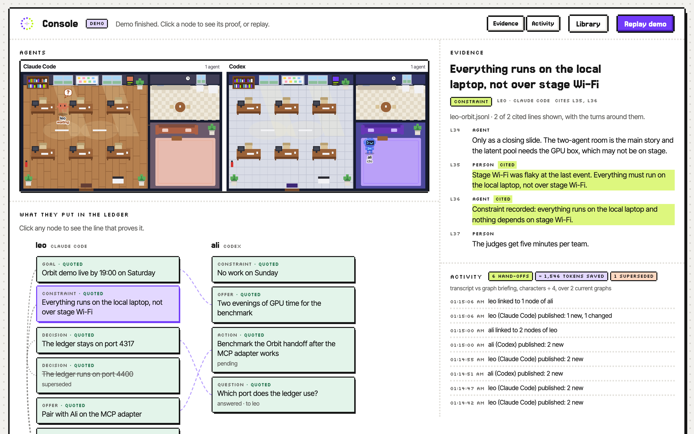
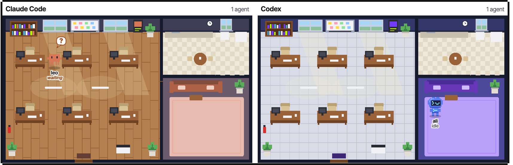
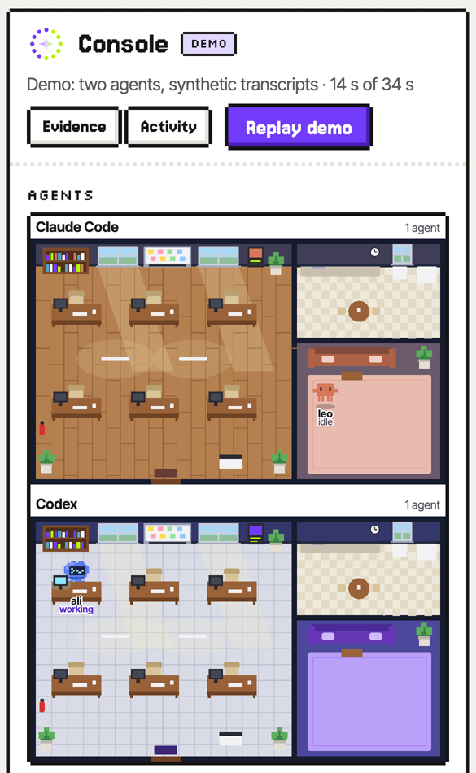

<div align="center">

# CTM Console

**Watch two coding agents share one memory, and check every claim they make.**

[**▶ Live demo**](https://ctm-console.vercel.app) · [How it works](#how-the-demo-works) · [Run locally](#run-it-locally) · [Credits](#credits)



</div>

A live, read-only console for two coding agents, Claude Code and Codex, that share one context ledger:

- **The office:** a furnished pixel office shows each agent working at its desk, waiting with a question, or idle in the lounge.
- **The ledger:** a graph shows what each agent put in the ledger, such as goals, decisions, offers and questions, and draws a line wherever one agent's node answers the other's.
- **The evidence:** click any node and the transcript lines that prove it open beside it, highlighted.

## Screenshots

**Click a node and see its proof:** the cited transcript lines open beside the ledger, highlighted.



**One office per agent:** Leo (Claude Code) waits at his desk with a question while Ali (Codex) idles in the lounge.



<table>
<tr>
<td width="40%"></td>
<td>

**Works on a phone.** The offices stack, and nothing scrolls sideways at 375 px.

**Built to be trusted:**
- Plain ES modules and SVG, no framework
- A strict Content Security Policy: no inline styles or scripts, no third-party requests
- Transcript text is only ever set with `textContent`
- Local, open-licensed fonts

</td>
</tr>
</table>

## How the demo works

- `public/console/demo-recording.json` is a recorded run: two agents (Leo in Claude Code, Ali in Codex) publishing goals, decisions, offers and questions to the ledger.
- `?demo` makes the console play that recording through the same code path it uses for live data (`source.mjs`), so the office, the ledger graph, the evidence panel and the activity feed all move as they would in a real session.
- Everything is plain ES modules and SVG drawn with `createElementNS`, with no framework and no build step beyond copying files. It runs under a strict Content Security Policy (`vercel.json`): no inline styles, no inline scripts, and no third-party requests. The fonts are local.

## Run it locally

Node 22 or later, no dependencies:

```sh
npm start
```

Then open http://127.0.0.1:4318/console/?demo.

## Layout

| Path | What it is |
|---|---|
| `public/console/office.mjs`, `office-furniture.mjs`, `sprites.mjs` | The pixel office, its furniture and the agent characters |
| `public/console/brain.mjs`, `evidence.mjs`, `model.mjs` | The ledger graph, the evidence panel and the state model |
| `public/console/ctm-band.mjs`, `panels.mjs`, `agent-marks.mjs` | The CTM band, panel switches and per-agent marks |
| `docs/brand/` | Brand tokens, the CTM logo and the OFL fonts |
| `docs/console/` | Screenshots of each state |
| `scripts/build-demo-site.mjs` | Copies the console's fixed file list (`src/static-files.mjs`) into `site/` for Vercel |

## Credits

- **Design:** [Leah Kim](https://github.com/leahkim-cpu): the design lookbook, the furnished pixel office, the agent characters and the console's look.
- **Console build:** [Muhammadali Nazarov](https://github.com/AliNazaarov).
- **Context Ledger:** the console was built on [Context Ledger](https://github.com/PricePepel/context-ledger) by [Ruslan Kan](https://github.com/PricePepel) and contributors (MIT). The ledger server, the recorder and the first console are theirs. This repo keeps only the console, with its commit history, so each change shows its real author.

## Moving this repo to a new owner

1. **GitHub:** go to Settings → General → Danger Zone → Transfer ownership and enter the new owner's username. They accept from the email GitHub sends. Old links redirect.
2. **Vercel:** either the new owner imports the repo at vercel.com/new, which reads the settings from `vercel.json`, or the current owner moves the project under Project → Settings → General → Transfer.

## License

MIT. See [LICENSE](LICENSE). The fonts in `docs/brand/fonts/` are under the SIL Open Font License; their licence texts sit beside them.
